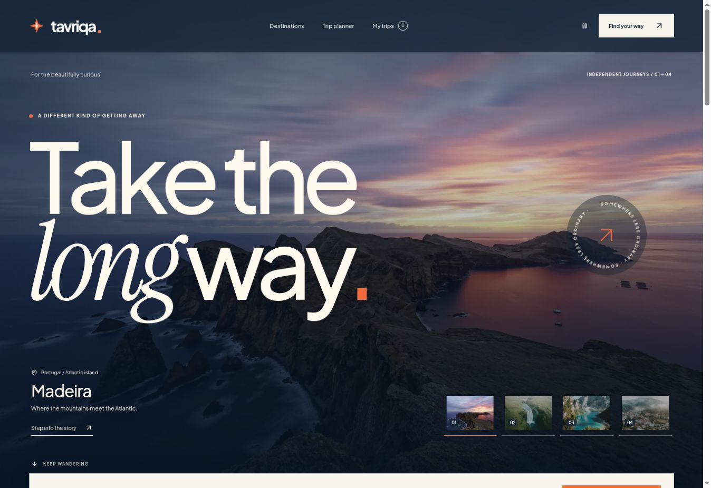

# Tavriqa

**Take the long way.** An original destination atlas and editable itinerary
experience by Rafayel Karamyan. Explore Madeira, South Iceland, the Dolomites
and Dilijan, then turn a three-day outline into a personal trip.

React, strict TypeScript, GSAP, React Three Fiber and authored CSS. Built for
GitHub Pages without a backend, API key or paid service.

[**Open the live demo →**](https://rafayelkaramyan.github.io/tavriqa/)



Verified on 18 October 2026: **38 unit tests and 38 browser scenarios passed**
across desktop Chromium, Firefox and Pixel 7 emulation. One mobile pointer-drag
entry intentionally skips. [Verification and deployment](https://github.com/RafayelKaramyan/tavriqa/actions/runs/39159001829)
publish the checked build to GitHub Pages. See the [validation record](docs/validation.md)
for coverage, live review and remaining limits.

## What you can do

- Explore an editorial homepage with destination scene transitions, image
  parallax, scroll reveals, a globe and a global motion pause.
- Search the atlas and filter coast, mountains or forest; search and view state
  are encoded in the URL.
- Read a destination story, bookmark it and start an editable trip.
- Rearrange stops with pointer or keyboard dragging. Explicit up/down and
  move-to-day controls offer another way to make the same changes.
- Add or remove places and empty days; edit dates, group size, personal notes
  and exact-cent allowances.
- See the selected day's approximate geographic locations and direct
  connections on a self-contained schematic map.
- Save up to 24 trips, duplicate or delete them, export JSON/text, print an
  itinerary, import a backup, or share a portable snapshot link.
- Recover from unreadable storage without silently discarding its bytes.

The globe loads near the viewport. WebGL is an enhancement: an SVG globe keeps
destination exploration available when WebGL is unavailable. Rendering uses
on-demand frames, capped pixel density and disposable texture resources.
Reduced-motion preferences are respected; text is kept at full opacity during
entrance animations.

## Run locally

Use Node **24** (minimum supported version: 22.12) and npm.

```sh
npm ci
npm run dev
```

Open the address printed by Vite, including `/tavriqa/`. The app uses hash routing,
so a Pages deployment needs no route-rewrite service.

```sh
npm run check       # strict types, lint, formatting and domain/store tests
npm run build       # TypeScript + production bundle
npm run preview     # serve the built application
```

On a machine that supports browser execution:

```sh
npx playwright install --with-deps chromium firefox
npm run build
npm run test:e2e
```

Playwright starts its own preview server on port 4173. The workflow runs
Chromium, Firefox and Pixel 7 emulation, retains failure traces and uploads
screenshots. The suite covers complete planner journeys, persistence, conflict
and recovery states, keyboard controls, representative axe scans and overflow
checks. See [validation](docs/validation.md).

## Code tour

| Area                      | Responsibility                                                                    |
| ------------------------- | --------------------------------------------------------------------------------- |
| `src/pages/`              | The atlas, destination stories, planner, saved collection and shared-trip preview |
| `src/components/`         | Editorial UI, lazy globe, schematic map, itinerary controls and dialogs           |
| `src/domain/catalog.ts`   | Four researched destinations and seven places per destination                     |
| `src/domain/trip.ts`      | Validated trip model, commands, integer-cent budget and direct distances          |
| `src/domain/transfer.ts`  | Portable snapshots, validated import, share tokens and exports                    |
| `src/state/repository.ts` | Versioned persistence, conflict checks and explicit recovery                      |
| `src/data/`               | Photo credits and public-domain land geometry                                     |

[Review guide](docs/review-guide.md) explains the architecture, a concrete
interview walkthrough and the tradeoffs.

## Scope and data

This is a personal portfolio concept, not a travel agency or booking service.
It has no payments, accounts, reservations, live prices or cloud synchronization.
Itineraries and allowances are illustrative. Stop durations exclude travel time;
map lines are direct connections, not driving or walking routes. Official access
and local conditions should be checked before travel.

Trips stay in this browser. Shared links contain the notes and allowances in a
snapshot; anyone with the link can read them. Imports always create new IDs.
Web Locks serialize supported tabs; without that API, revision checks cannot
guarantee atomic writes between tabs. Use exported trip files for backups.

## Credits

Photography: Colin Watts, Rolands Varsbergs, Finge Holden and IsaaK Alexandre
KaRslian on Unsplash. Globe geometry: Natural Earth, public domain. Fonts:
Plus Jakarta Sans and Instrument Serif, SIL Open Font License.

See [assets and sources](docs/assets-and-sources.md) for exact source links and
license notes. Project source is [MIT licensed](LICENSE); third-party assets
retain their respective terms.
